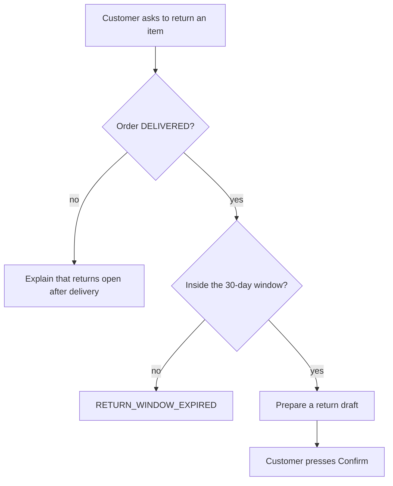
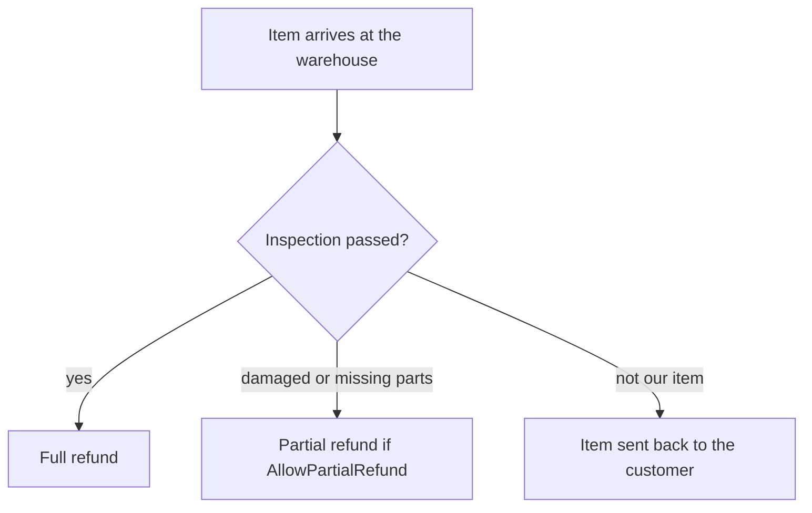

# How a Return Works — Step by Step

## Step 1 — Request a return

The customer asks support or the assistant to start a return. The assistant checks that the order is DELIVERED and inside the return window, then prepares a return request that the customer confirms in the app.

## Step 2 — Ship the item back

A prepaid return label is emailed after the customer confirms. The label is valid for 14 days. Pack the item with all parts and accessories.

## Step 3 — Inspection and refund

The warehouse inspects the item within 2 business days of arrival. The refund is issued as soon as the inspection passes.

## Cancelling an order

An order can be cancelled while its status is PROCESSING. Once it is SHIPPED it cannot be cancelled; the customer must wait for delivery and start a return. The assistant never cancels on its own: it prepares a cancellation and the customer presses Confirm.

## Error codes

- `RETURN_WINDOW_EXPIRED` — the delivery date is more than 30 days ago.
- `ORDER_NOT_DELIVERED` — returns open only after delivery.
- `ORDER_ALREADY_SHIPPED` — the order can no longer be cancelled.
- `RETURN_LABEL_ID_ALREADY_PRINTED` — a label already exists for this return; reuse it.
